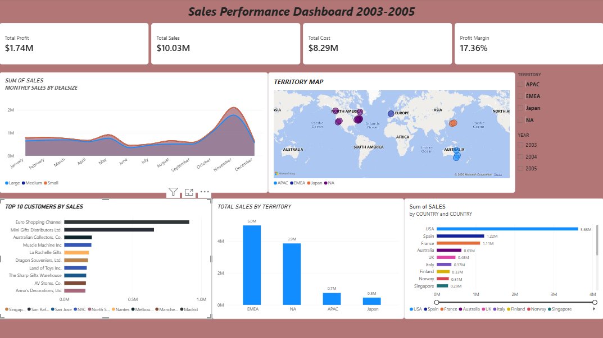

# Sales Performance Dashboard

A Power BI dashboard analysing sales, profit and territory performance from 2003 to 2005.

## Key insights
- Total sales: $10.03M
- Total profit: $1.74M (17.36% margin)
- USA is the top market with $3.63M in sales
- Sales peak in November

## Files
- `sales_dashboard.pbix`: Power BI file (open with Power BI Desktop)
- `Dashboard.png`: screenshot of the dashboard
- `sales_data_sample.csv`: source data

## Tools used
Power BI Desktop, DAX
